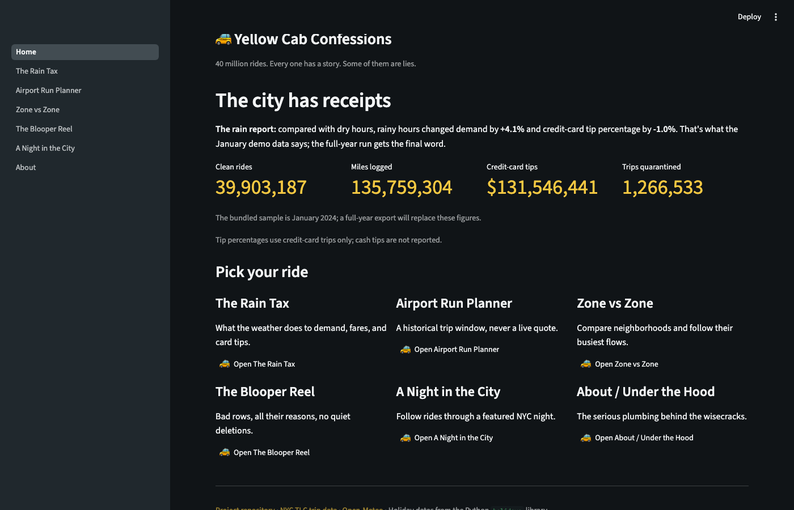
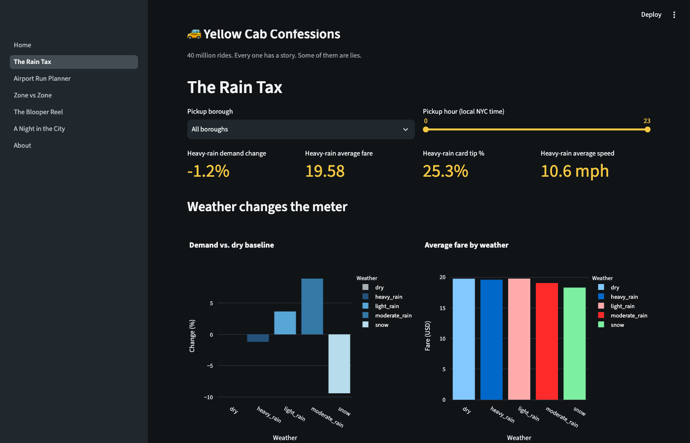
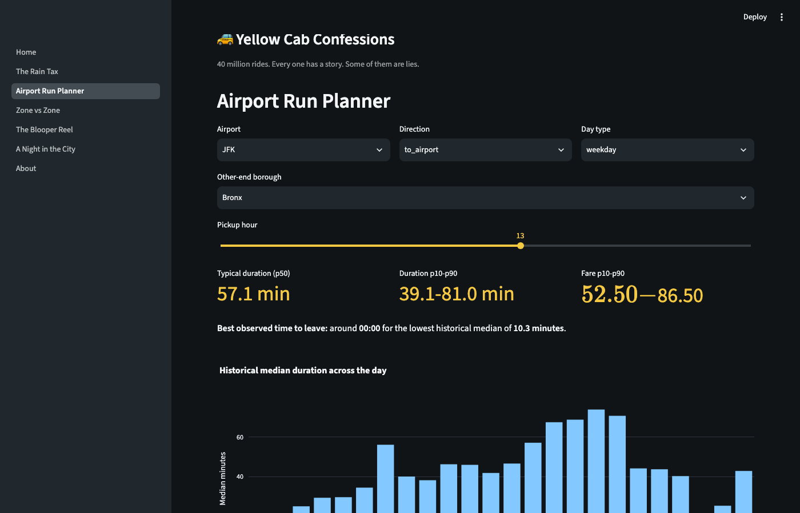
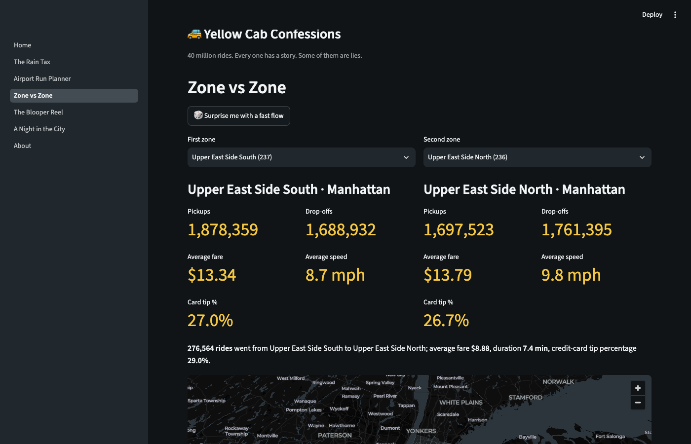
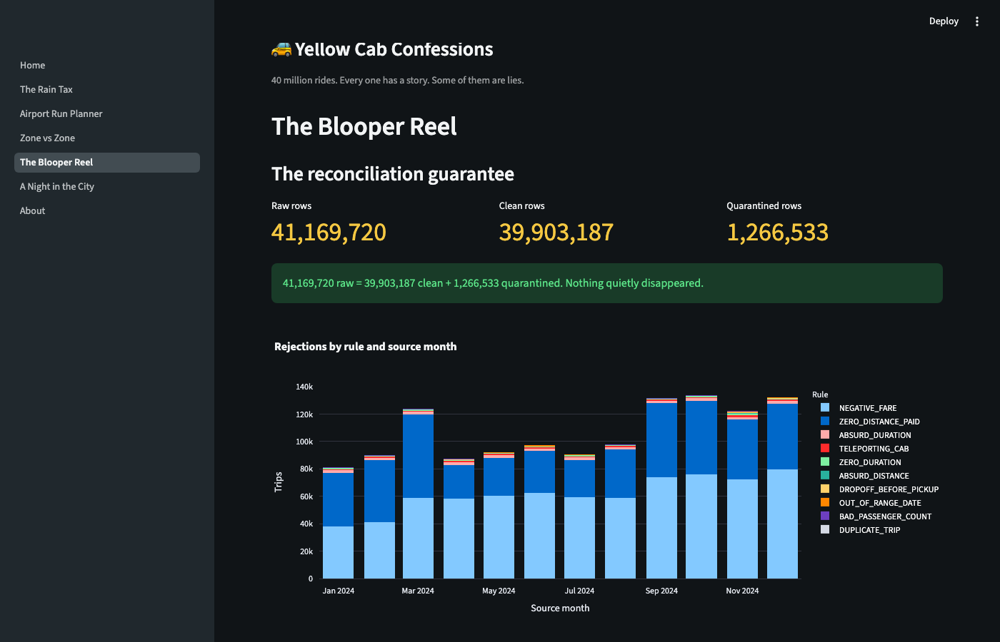
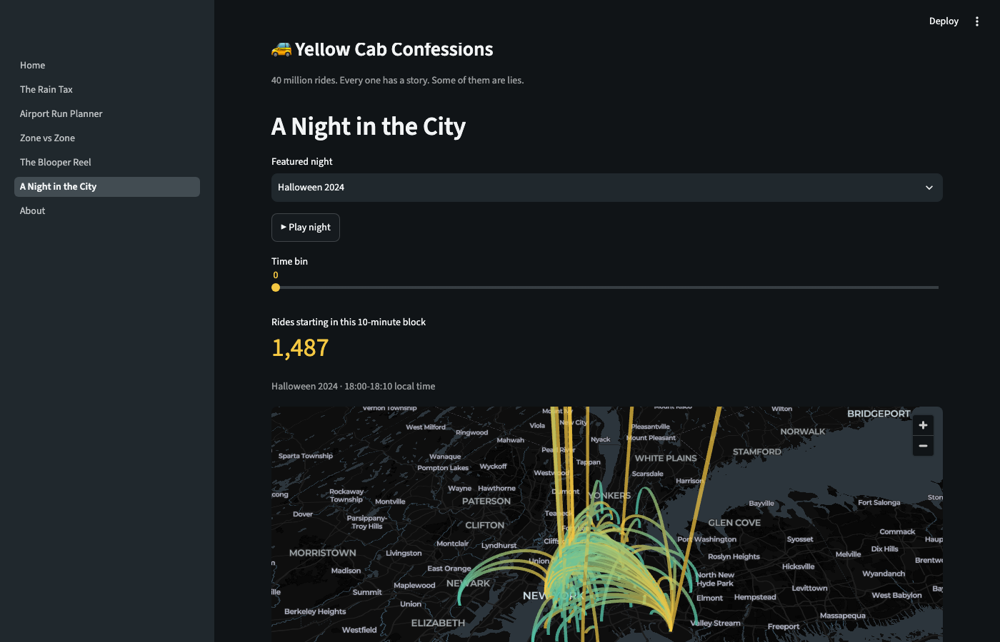
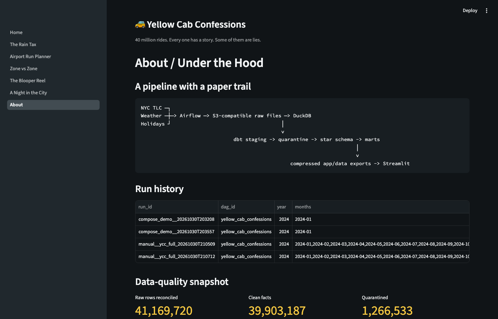

# 🚕 Yellow Cab Confessions

### *40 million rides. Every one has a story. Some of them are lies.*

[](LICENSE)

**[▶ Try it live](#try-it-live)** · [How to use the app](#how-to-use-the-app) · [What it found](#cool-things-it-found) · [Run it yourself](#run-it-yourself)



### 🎬 Watch the 45-second demo


---

## What is this?

Every year, New York's yellow taxis make tens of millions of trips, and each one is logged: where it started, where it ended, how much it cost, what the weather was like.

**Yellow Cab Confessions** takes every one of the **41 million rides from 2024**, cleans them up, and turns them into a small, playful website. You can ask it things like *"Does rain make people tip less?"*, *"When's the best time to leave for JFK?"* and *"What did the city look like on New Year's Eve?"*

It also does something most projects skip: **it doesn't hide the bad data.** Rides with impossible details (a taxi that "drove" at 300 mph, a trip that ended before it began) are set aside, explained, and put on display in their own gallery.

> The app talks like a wise-cracking New York cabbie who has seen everything. The engineering underneath is serious.

---

## Cool things it found

Every number below is calculated straight from the data, not typed in by hand.

| | |
|---|---|
| 🚖 **39.9 million** clean rides analysed | 🛣️ **135.8 million** miles driven, about 285 round trips to the Moon |
| 💵 **$131.5 million** in card tips | 🗑️ **1.27 million** rides rejected as bad data (3.1%) |
| 🌧️ Rainy hours have about **4% more rides** than dry ones | 💳 Tips are roughly **1 percentage point lower** in the rain |

**Fun facts:**
- The most common bad-data culprits are rides with a **negative fare** (about 739,000) and rides that were **paid for but went nowhere** (about 490,000).
- About 13,000 rides were logged as a **"teleporting cab"**, going faster than 80 mph through Manhattan.
- Tips only exist in the data for card payments. **Cash tips are invisible**, so the tip numbers are for card riders only.

---

## How to use the app

No account, no install, no jargon. Open it and click around. The left sidebar switches between pages.

### 🏠 Home
The front door. You get the big numbers, the headline "confessions", and a card for each page.

### 🌧️ 1. The Rain Tax
*Does bad weather change how people ride?*
Pick a borough and a range of hours. The charts compare **dry, rainy and snowy** weather: how many rides there are, how much they cost, how well people tip, and how fast the cabs go.



### ✈️ 2. Airport Run Planner
*When should I leave for the airport?*
Choose **JFK, LaGuardia or Newark**, whether you're going **to or from** it, the type of day (weekday, weekend or holiday) and the hour. You get:
- a typical trip time with a likely range,
- a typical fare range,
- a chart of the **best time to leave** across the whole day,
- a short plain-English verdict.

*This is based on past trips. It is not live traffic and not a price quote.*



### 🗺️ 3. Zone vs Zone
*How does one neighbourhood compare with another?*
Pick any two zones and see them side by side: rides, fares, speed and tipping habits, plus a map of the busiest routes. Not sure what to pick? Hit **Surprise me**.



### 🤡 4. The Blooper Reel
*The most entertaining page.*
Shows how 41 million raw rides became 39.9 million clean ones, which kinds of errors were most common, and a gallery of the weirdest rejected rides, each with a funny caption.

A **"nothing went missing" check** sits on the page: *original rides = clean rides + set-aside rides*. Every single ride is accounted for.



### 🌃 5. A Night in the City
*Watch the city move.*
Choose a famous night (New Year's Eve, July 4th, Halloween, or the rainiest night of the year) and press **play**. Glowing arcs show rides crossing the city in 10-minute steps, with a live count of rides in progress.



### 🔧 About / Under the Hood
For the curious: how it was built, how the data flows, and the history of every run.



---

## Try it live

🔗 **Live app:** *coming soon (link added once deployed)*

---

## How it works (the simple version)

```
 Public data  →  Download  →  Clean & check  →  Summarise  →  The app
 (taxis, weather,   (automatic)    (bad rides set aside)   (small tables)   (what you see)
  holidays)
```

1. **Collect.** It downloads the official NYC taxi records, hourly weather for the city, and the list of holidays. All of it is free and public.
2. **Clean.** Each ride is checked against 11 sanity rules. Good rides move on. Bad rides are set aside with the reason attached.
3. **Organise.** The clean rides are arranged into tidy tables, one for rides and others for zones, dates, weather and payment types.
4. **Summarise.** Small summary tables are built, one per page of the app.
5. **Show.** The app reads those summaries and draws the charts and maps.

Because the app only reads small summary files (about 1 MB in total), it is fast and free to host. It doesn't need the 41 million rows once the summaries exist.

---

## Why you can trust the numbers

- **Nothing is deleted quietly.** Rejected rides are kept, labelled with a reason, and shown in the Blooper Reel.
- **A built-in "does it add up?" check.** Original rides always equal clean rides plus rejected rides.
- **74 automatic checks** pass on every full run, covering things like unique IDs, sensible fare and speed ranges, and complete weather coverage.
- **Honest caveats:** see [Limitations](#limitations).

### The bad-data rules

| Rule | What it catches |
|---|---|
| Negative fare | Money paid *to* the passenger, or a fare of zero or less |
| Dropoff before pickup | The ride ended before it started |
| Zero duration | Under 30 seconds but over half a mile |
| Absurd duration | A trip longer than 6 hours |
| Zero distance, paid | Went nowhere but charged a fare |
| Absurd distance | More than 100 miles |
| Teleporting cab | Average speed above 80 mph |
| Out-of-range date | A ride dated outside the month of its file |
| Bad passenger count | More than 8 passengers |
| Unknown zone | Pickup or dropoff place doesn't exist in the zone list |
| Duplicate | An exact copy of another ride |

---

## Run it yourself

You'll need Python 3.11 or newer and Git. The quick version runs on a normal laptop with one month of data.

```bash
git clone https://github.com/bonsakel/yellow-cab-confessions.git
cd yellow-cab-confessions
make setup
make demo-lite     # downloads one month, cleans it, builds the app data
make app           # opens the app in your browser
```

**Just want to see the app with the included data?** After `make setup`, run `make app`. The summary files are already in the repo.

**Want the full automated version?** `make demo` runs everything through Apache Airflow (needs Docker). `make full` processes the whole year and needs about 10 GB of disk and 8 GB of memory (it took about 35 minutes on the author's machine).

Other handy commands: `make test` (run the checks), `make lint` (tidy-code checks), `make clean` (remove local data).

---

## Under the hood (for the technical reader)

| Layer | Tool |
|---|---|
| Automation | Apache Airflow (Docker) |
| Raw file storage | MinIO (S3-compatible, so it can swap to AWS S3 or Cloudflare R2) |
| Database | DuckDB |
| Cleaning and modelling | dbt Core, a star schema with quarantine and marts |
| App | Streamlit, Plotly, pydeck |
| Quality | pytest, dbt tests, ruff, sqlfluff |

Key design choices:
- **All the logic is plain Python** in [`ycc/`](ycc). Airflow just calls it, so the pipeline also runs without Airflow.
- **Safe to re-run.** Loading a month twice changes nothing, thanks to a log of loaded files and delete-then-insert loading.
- **Daylight saving handled.** Taxi times are local New York time, so weather is converted to match, including the repeated hour in November.
- **Tip percentages use card payments only**, since cash tips aren't recorded.
- **Thresholds live in config**, not buried in SQL.

Full build log and decisions: [PROGRESS.md](PROGRESS.md).

---

## Limitations

- Airport and zone numbers are **historical averages**, not predictions or live traffic.
- Weather comes from **one station (Central Park)** and is applied to the whole city.
- Tips cover **card payments only**.
- It's an independent portfolio project, not affiliated with the NYC TLC.

---

## Data and licence

- Taxi trips and zone maps: [NYC Taxi & Limousine Commission](https://www.nyc.gov/site/tlc/about/tlc-trip-record-data.page)
- Weather: [Open-Meteo](https://open-meteo.com/) (historical archive)
- Holidays: the Python [`holidays`](https://github.com/vacanza/holidays) library

Details in [NOTICE.md](NOTICE.md). Code is released under the [MIT License](LICENSE).

---

*Built by Kelvin Bonsu. Hop in, the meter's running.* 🚕
